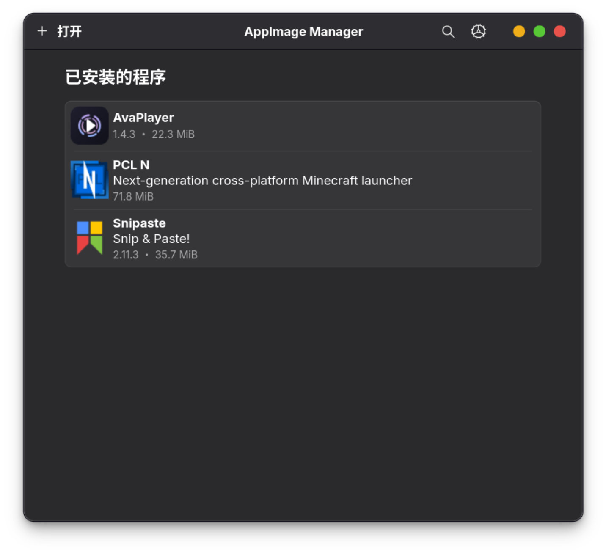
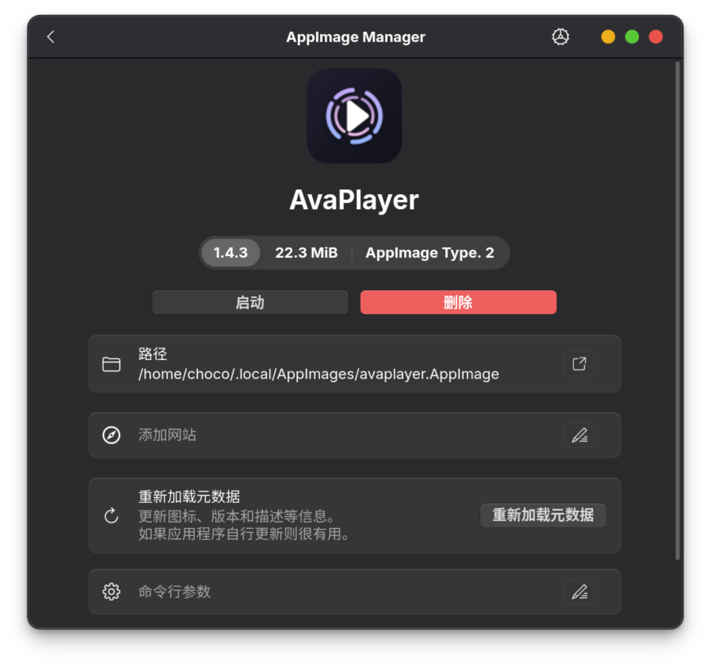
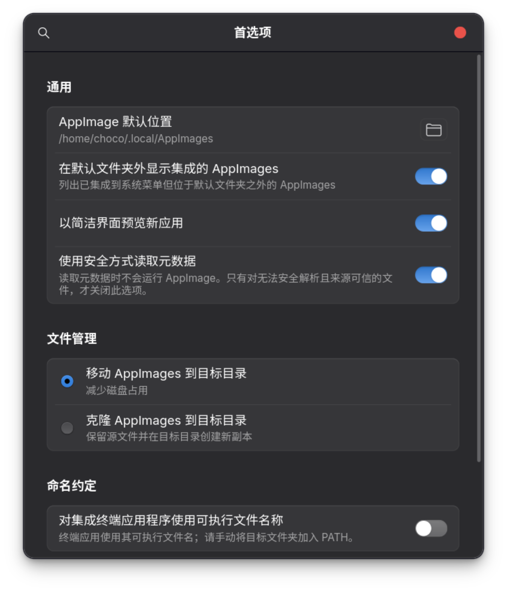

# AppImage Manager

使用 Rust、GTK4 和 libadwaita 构建的本地 AppImage 管理器。

## 界面预览

| 首页 | 详情 | 设置 |
| --- | --- | --- |
|  |  |  |

## 许可证

代码和资源采用 BSD-3-Clause 许可证，详见 [LICENSE](./LICENSE)。

`appimage-rs` 及其他第三方依赖保留各自的许可证。
